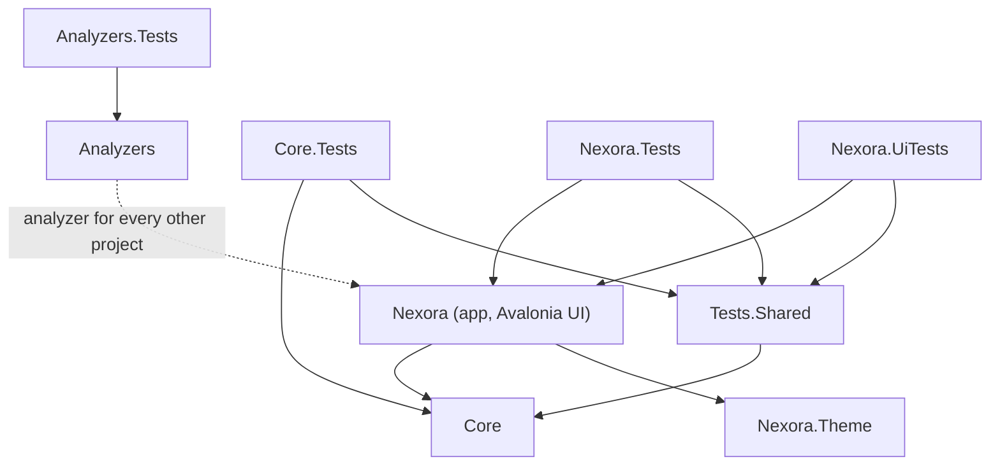
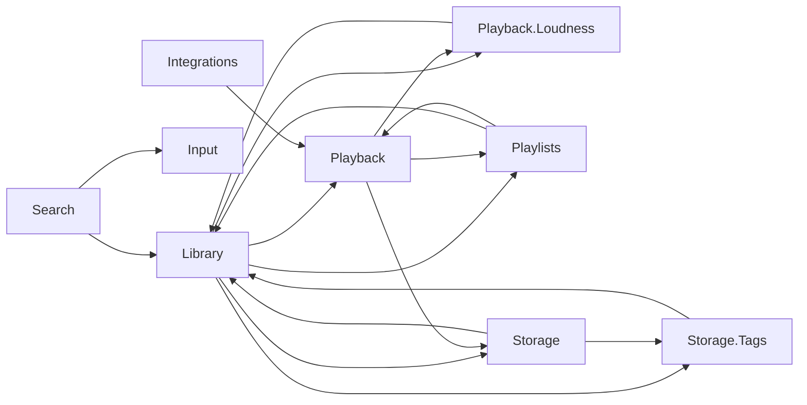
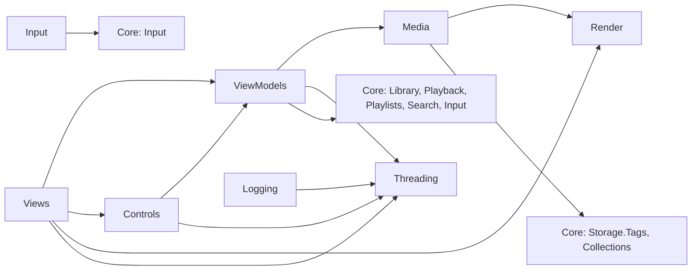

# Module map

## Projects

| Project | Path | Role |
|---|---|---|
| Core | `src/Core` | Domain and infrastructure: library, playback, playlists, search, storage, integrations. References no other project. |
| Nexora | `src/Nexora` | Desktop app: entry point, composition root, view models, views, controls, rendering. |
| Nexora.Theme | `src/Nexora.Theme` | Avalonia theme: colors, typography, control templates, animation resource keys. |
| Analyzers | `src/Analyzers` | Roslyn analyzers enforcing the project code style (`NX0001`–`NX0011`); attached to every other project by `Directory.Build.props`. |
| Core.Tests | `tests/Core.Tests` | Unit tests for Core. |
| Nexora.Tests | `tests/Nexora.Tests` | Unit tests for view models, logging, animations, media and rendering helpers. |
| Nexora.UiTests | `tests/Nexora.UiTests` | Headless UI tests running the real `MainWindow`. |
| Tests.Shared | `tests/Tests.Shared` | Test helpers shared between test projects. |
| Analyzers.Tests | `tests/Analyzers.Tests` | Tests for the style analyzers. |

## Core modules

`Input`, `Integrations`, `Library`, `Playback` and `Storage` also use `Logging`.

| Module | Path | Contents |
|---|---|---|
| Library | `src/Core/Library` | `MusicLibrary` (loads tracks, artist index), `AudioTrack`/`IAudioTrack`, `Artist`, `Metadata`, `LoudnessScanner` (background loudness analysis), `TrackTagWriter` (edits title/artists and saves loudness tags). |
| Playback | `src/Core/Playback` | `AudioPlayer`/`IAudioPlayer` (play, pause, next/previous, skip, volume), `IMediaEngine` with the LibVLC `VlcMediaEngine`, `PlaybackState`, `PlaybackStatus`. |
| Playback.Loudness | `src/Core/Playback/Loudness` | `ILoudnessAnalyzer` / `VlcLoudnessAnalyzer`, `LoudnessMeter`, `LoudnessGain` (normalization to -14 LUFS). |
| Playlists | `src/Core/Playlists` | `Playlist`, `PlaybackQueue`, `PlaylistItem`/`IPlaylistItem`. |
| Search | `src/Core/Search` | `TrackSearchQuery` and match ranking (`TrackMatch`, `MatchField`, `MatchKind`, `MatchBoundary`, `QueryVariant`). |
| Storage | `src/Core/Storage` | `FileTrackLoader` (scans the music directory), `MusicDirectoryProvider`, `SupportedAudioFormatsProvider`, `FileVolumeStorage`, degree-of-parallelism providers. |
| Storage.Tags | `src/Core/Storage/Tags` | TagLib-based `TagLibMetadataLoader`, `TagLibMetadataSaver`, `TagLibTrackCoverLoader`; `MetadataChange`, `LoudnessTags`. |
| Input | `src/Core/Input` | `KeyboardLayoutTranslator`, `KeyboardLayout`, `KeyboardKey`, `IKeyboardLayoutProvider`. |
| Integrations | `src/Core/Integrations` | Discord Rich Presence: `DiscordRichPresenceService`, `IDiscordClient` / `DiscordRpcClientAdapter`. |
| Logging | `src/Core/Logging` | `LoggingExtensions`, `LibVlcLogForwarder`, `DiscordRpcLogger`. |
| Collections | `src/Core/Collections` | `LruCache`. |

## Nexora modules

| Module | Path | Contents |
|---|---|---|
| Entry point | `src/Nexora/Program.cs`, `App.axaml(.cs)` | Single-instance check, logging and crash logger setup, Avalonia app builder, animation resources, DI container. |
| Composition root | `src/Nexora/CompositionRoot.cs` | Registers all services, paths and platform-specific implementations. |
| ViewModels | `src/Nexora/ViewModels` | `MainWindowVm`, `PlaybackVm`, `QueueVm`, `SearchBarVm`, `TrackEditorVm`, `CoverViewerVm`, `TrackViewVm`, per-track `TrackControlVm` via `TrackControlVmRegistry`. |
| Views | `src/Nexora/Views` | `MainWindow`, `PlaybackControl`, `SearchBar`, `TrackArea`, `TrackGrid`, `TrackEditor`, `CoverViewer`, `WindowButtons`, window resize helpers. |
| Controls | `src/Nexora/Controls` | Reusable controls: `TrackControl`, `TrackTile`, `TrackView`, `SegmentedControl`, `PopupBackdrop`, `Icon`, `SmoothScroller`. |
| Render | `src/Nexora/Render` | `DitheringControl` / `DitherGradientEffect` (shader gradient), `CardTransform` (3D cover rotation), `RenderScaleProvider`. |
| Media | `src/Nexora/Media` | `CoverCache` / `ICoverCache`: decoding and caching cover bitmaps at screen scale. |
| Animations | `src/Nexora/Animations` | Animation settings model loaded from `animations.json` and turned into resources by `AnimationResourceFactory`. |
| Input | `src/Nexora/Input` | Platform keyboard layout providers: Windows, Wayland, unsupported fallback. |
| Logging | `src/Nexora/Logging` | `LoggingInitializer`, `SessionLogFiles`, `CrashLogger`, `AvaloniaLogSink`, `DiagnosticsLogListener`, `LogLevelArgument`. |
| Threading | `src/Nexora/Threading` | `IUiDispatcher` / `AvaloniaUiDispatcher`. |
| Converters | `src/Nexora/Converters` | `IconNameToSourceConverter`. |
| Assets | `src/Nexora/Assets` | Icons (SVG), shaders, default `animations.json`. |

## Other directories

| Path | Contents |
|---|---|
| `scripts` | Publish (`Publish.ps1`, `publish.sh`), tests (`Test.ps1`, `test.sh`), CRAP score (`Crap.ps1`), profiling (`profile.sh`), per-platform publish configs. |
| `packaging/aur` | Arch Linux package (`PKGBUILD`, desktop entry, launcher). |
| `.github/workflows` | CI: test and build, release. |
